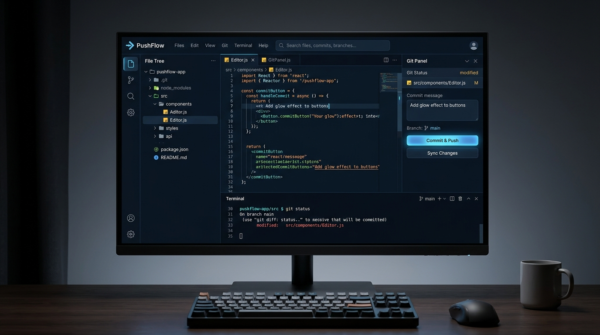

<div align="center">
  

  # 🌊 PushFlow

  **Modern, Fully-Featured GitHub & GitLab Web Client**

  [](https://pushflow.pages.dev/)
  []()
  []()
  []()
  []()
  
  <p align="center">
    Manage repositories, edit code in real-time, stage commits, and track history seamlessly—all from a sleek, responsive browser interface.
  </p>
</div>

<br />

---

## ✨ Why PushFlow?

**PushFlow** is designed for developers who want a lightweight, powerful, and accessible Git client right in their browser. No need to open a heavy IDE just to make a quick commit or review code.

### 🚀 Live Preview
**Experience the magic yourself:** [👉 pushflow.pages.dev](https://pushflow.pages.dev/)

---

## 🎨 Features At A Glance

<div align="center">
  
</div>

<br />

### 📂 Repository Management
View, search, and clone public or private GitHub and GitLab repositories instantly. 

### 📝 Real-Time Code Editor
Integrated **Monaco Editor** (the engine behind VS Code) provides syntax highlighting, auto-completion, and a professional coding experience inside the browser.

### 🌿 Advanced Source Control
- **Stage & Unstage:** Precisely select which files to commit.
- **Push & Pull:** Sync with your remote repository instantly.
- **Revert System:** Undo mistakes and rollback to any previous commit with a single click.

### 📱 Responsive & Fast
A fully responsive, dark-mode optimized interface that automatically adjusts to mobile, tablet, and desktop screens without breaking the layout.

### ⌨️ Keyboard Shortcuts

Speed up your workflow with our newly added global shortcuts:

| Shortcut | Action |
| :--- | :--- |
| <kbd>Ctrl/Cmd</kbd> + <kbd>P</kbd> | Open Command Palette / Search Files |
| <kbd>Ctrl/Cmd</kbd> + <kbd>Shift</kbd> + <kbd>F</kbd> | Global Search |
| <kbd>Ctrl/Cmd</kbd> + <kbd>/</kbd> | Show Keyboard Shortcuts Help |
| <kbd>Ctrl/Cmd</kbd> + <kbd>S</kbd> | Save Active File |
| <kbd>Ctrl/Cmd</kbd> + <kbd>W</kbd> | Close Active Tab |
| <kbd>Esc</kbd> | Close Modals & Overlays |

---

## 🛠️ Tech Stack

| Technology | Description |
| --- | --- |
| **Frontend** | React 18, TypeScript, Vite |
| **Styling** | Tailwind CSS (Utility-first styling, Dark Mode UI) |
| **Editor** | `@monaco-editor/react` |
| **Backend/Auth** | Firebase (Auth, Firestore) & GitHub REST API |

---

## 💻 Getting Started (Local Development)

### Prerequisites
Make sure you have **Node.js (v18+)** and **npm/yarn** installed.

### Installation

1. **Clone the repository**
   ```bash
   git clone https://github.com/your-username/pushflow.git
   cd pushflow
   ```

2. **Install dependencies**
   ```bash
   npm install
   ```

3. **Start the development server**
   ```bash
   npm run dev
   ```

4. **Build for production**
   ```bash
   npm run build
   ```

---

## 🔒 Security Notice

This codebase is **100% safe to be open-sourced and published publicly**. 
- **No Hardcoded Tokens:** GitHub Personal Access Tokens (PAT) and OAuth tokens are retrieved dynamically and stored securely in the browser's `localStorage`. They are never hardcoded in the repository.
- **Public Firebase Config:** By design, Firebase API keys for web clients are safe to be public as long as your `firestore.rules` are properly secured (which they are in this app).

---

<div align="center">
  <sub>Handcrafted by Tasfia</sub>
</div>
